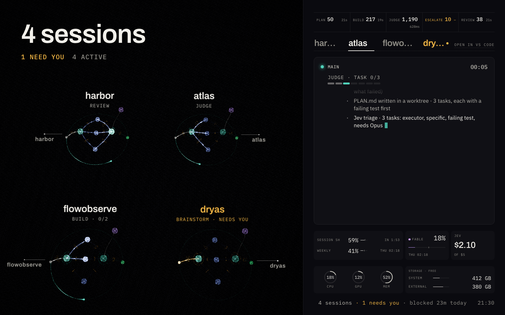

# flowobserve

Ambient monitor for live Claude Code sessions. Keep it open on a second screen beside VS Code: it shows where every session sits in the workflow loop and tells you, within seconds, when one needs you and what to do next. Otherwise it stays quiet.



**[Try the live demo](https://dryasstudio.com/demos/flowobserve/)**: the board running on simulated sessions, in your browser, nothing to install.

## What it does
- **Sees every session.** One card per Claude Code chat, grouped by project, with each git worktree labelled. Sessions appear on their first hook event and retire on `SessionEnd` or after 24 h idle.
- **Knows the stage.** Infers where each session is in the loop (Brainstorm, Plan, Build, Review, Ship) from Claude Code hooks and `.orchestrate/PLAN.md`.
- **Tells you when you are needed.** A session waiting for an answer, blocked by a denied tool, or due a handoff gets the only highlight on screen, with its question shown large and a one-click jump to the project in VS Code. Everything else is calm.
- **Watches context.** Each card shows `N% LEFT` of the context window. It turns amber and then red as the chat fills, and the card then shows **Handoff**, **Clear** and **Resume** buttons: each focuses the chat in VS Code and copies the next thing to type.
- **Shows the loop live.** A 3D view of the loop: sub-agent builders, packets moving between stages, a ring wave on ship. Motion follows real activity and goes still when nothing runs. Hover a node to inspect it; free camera; `prefers-reduced-motion` is respected.
- **Tracks limits and cost.** 5-hour and weekly plan usage per Claude account (and the Fable meter, when your Claude usage cache reports one) with a pace marker, a hint when one account nears its limit, and API-equivalent cost per project and model (click the usage tiles).
- **Watches the machine.** CPU, GPU (macOS), memory pressure and disk space. Shown only when something needs attention.
- **Pages itself.** With many sessions, cards page automatically and the loop view follows whichever session needs you. A manual pick holds for 2 minutes.
- **Installs as an app.** A PWA (progressive web app) served from `http://127.0.0.1:4317`: add it to the Dock or home screen, use it full screen, portrait or landscape.

With the Dryas Workflow (see below):
- Judge and Escalate stages, and escalations (Sonnet to Opus to Fable) shown without counting as needing you.
- Build lanes, one per plan task.
- Jev's monthly spend against budget.
- Per-stage call counts and p50/p95 times, drift warnings, and total time blocked on you.

## Requirements
- macOS 14+ or Windows 10/11.
- Node 24+ and pnpm 10.
- Python 3.9+ (macOS uses the system `/usr/bin/python3`).
- VS Code with the Claude Code extension.
- Optional: iTerm2 (macOS), to open, restore and jump between sessions from the board.
- Optional: the *Claude Code Usage Status* VS Code extension (by mhelbich), for live plan limits.

## Install
macOS:
```sh
git clone https://github.com/promprit/flowobserve && cd flowobserve
pnpm install && pnpm build
scripts/install.sh --edition vscode   # or iterm, or both
```
`install.sh` copies the hook to `~/.flowobserve/bin`, writes a launchd agent, starts the server and wires `~/.claude`. It is safe to re-run.

Windows (PowerShell):
```powershell
git clone https://github.com/promprit/flowobserve; cd flowobserve
pnpm install; pnpm build
powershell -ExecutionPolicy Bypass -File scripts\setup.ps1
powershell -ExecutionPolicy Bypass -File scripts\start.ps1
```
There is no auto-start on purpose: antivirus tools often flag hidden launchers and logon tasks as malware persistence, so you start the board yourself in a visible window.
Re-run `setup.ps1` after a Python or Node upgrade: the hook command pins the interpreter path.

`start.ps1` sets `FO_PORT=4317` and `FO_EDITION=vscode` itself, so setting those variables beforehand has no effect (Windows is always the VS Code edition). It does respect `FO_HOME` and every other variable below.

Then open `http://127.0.0.1:4317` and use Add to Dock / Install if you want the app form.

**Keyboard.** On the board, `⌘1` to `⌘9` select tab 1 to 9 of the tab strip, as clicking it does (portrait: focus that session; landscape: show that project). `⌘9` selects the last tab when there are more than nine, and a number with no tab does nothing. A `⌘N` badge shows on the tabs while you hold `⌘`. This works in the installed app window; a normal browser tab keeps `⌘1` to `⌘9` for its own tabs.

## Uninstall
- macOS: `scripts/uninstall.sh`
- Windows: `powershell -ExecutionPolicy Bypass -File scripts\uninstall.ps1`

Both remove the flowobserve hooks and statusline wrapper from `~/.claude` and keep your `~/.flowobserve` data and `.bak` files. On macOS, `uninstall.sh` with no `CLAUDE_DIR` also unwires every other config dir listed in `~/.flowobserve/accounts.json` (one line per dir; dirs that no longer exist are skipped) and empties that list. With `CLAUDE_DIR` set to another dir it unwires only that dir and leaves the server running for the rest, unless no account is left, in which case it does the full teardown. The full teardown also stops and removes the launchd agent, the `flowobserve-open.app` helper and `helper.json`. On Windows, `uninstall.ps1` also removes the temporary pnpm shim if setup made one, and tells you to close the server window.

## Several accounts
Run two Claude accounts on one Mac, each in its own config dir, and see both on one board. Install once per dir:
```sh
scripts/install.sh                                                   # ~/.claude
CLAUDE_DIR=~/.claude-personal FO_ACCOUNT_LABEL=Pro scripts/install.sh
```
Each run wires that dir (hooks and statusline; Dryas is optional) and records it in `~/.flowobserve/accounts.json`, in the order you install. Re-running for a dir keeps its label unless you pass `FO_ACCOUNT_LABEL`. The server, launchd agent and hook copy are shared. Wire a dir only through `install.sh`: it tags that dir's hook commands with the account.

With more than one account, every card names its account (`NO DRYAS` marks a dir without the Dryas Workflow), the usage tiles show one 5-hour and weekly pair per account, and when an account reaches `FO_SWITCH_AT` of its 5-hour limit the board says, for example, `Team 92% of 5h: /handoff, continue in Pro`. It is a hint only: flowobserve never switches accounts. In portrait the slim row marks another account near its limit with its first letter.

An account reports limits through its statusline (the default account can also report them through the usage cache). When a config dir has no `statusLine`, the installer adds a minimal one (`fo_status.py`: the model and the 5-hour percentage), wrapped like any statusline, and removes it again on uninstall. An existing statusline is never replaced: it is wrapped when its command is simple, otherwise left alone, and that account then reports no limits (copy the statusline into a simple script to get them). This is macOS only. Cost per project includes every account but is not split by account.

To remove one account: `CLAUDE_DIR=~/.claude-personal scripts/uninstall.sh` (the server keeps running for the others; when it was the last account listed, the launchd agent is removed too).

### Pick the account per session: `cl`
`install.sh` also puts a small launcher at `~/.flowobserve/bin/cl` (add `~/.flowobserve/bin` to your `PATH`; the installer prints the line). It is a Python 3 script (`#!/usr/bin/env python3`). Start sessions with `cl` instead of `claude`:
```sh
cl                    # picks the account, then runs claude with your arguments
cl --pro              # or --team, or --account LABEL
cl --resume <id>      # always the account the session was recorded under
cl --dry-run          # show the choice and the command, start nothing
```
It decides in this order: your flag; for `--resume <id>` (also `--resume=<id>`, `-r <id>`), the session's own account, from flowobserve or, when it does not know the id, from an account whose `projects/*/<id>.jsonl` transcript exists (so `--resume` falls through only when neither the server nor the transcripts know the id); the longest matching rule in `accounts.json`; for `-c`, `--continue` and `--resume` with no id, the account whose `projects/<this folder>/` holds the newest transcript (the usage step is skipped; no transcript there means the default account); the default account if its 5-hour use is under `FO_SWITCH_AT` (or unknown); else the account with the lowest known 5-hour use under it; else the default account. If flowobserve is not running, it uses the default account. It prints its reason in one line, for example `cl → Pro (Team 5h 93%)`. Rules are optional and edited by hand; a rule matches the current folder or any folder under it, also through symlinks:
```json
{"accounts": [...], "rules": [{"path": "~/clients", "label": "Team"}]}
```
A rule whose label names no account prints `cl: rule <path> names unknown account <label>` and is skipped; `cl` then carries on with the usage-based choice.

When `cl` is installed, the board's Open and Restore buttons in iTerm2 start sessions through it.

## Configuration
Read by the server at start. On macOS, launchd does not see shell exports: put overrides in the plist's `EnvironmentVariables` (`~/Library/LaunchAgents/com.promprit.flowobserve.plist`), then restart. Re-running `install.sh` rewrites the plist.

| Variable | Default |
|---|---|
| `FO_HOME` | `~/.flowobserve` (spool, SQLite, log) |
| `FO_PORT` | `4317` (always bound to 127.0.0.1) |
| `FO_PROJECTS_ROOT` | none (the Open sheet is empty without it). On Windows, `setup.ps1` reads it from the environment and records it in `helper.json` (a relative or missing folder only warns and skips the file); `start.ps1` passes it to the server, falling back to the root recorded in `helper.json`. |
| `FO_STATIC` | `pwa/dist` in this repo |
| `FO_JEV_LOGS` | `~/.claude/jev/logs` |
| `FO_USAGE_CACHE` | `~/.claude/usage-cache.json` |
| `FO_DISKS` | `/:System` (`path:label`, comma-separated, max 4; on Windows for example `C:\:System`). On macOS, `FO_DISKS=/:System,/Volumes/Data:Data ./scripts/install.sh` writes it to the launchd plist; later installs keep it |
| `FO_SESSIONS_DIR` | `<dir>/sessions` of every account in `accounts.json` (else `~/.claude/sessions`); set it to read one folder only |
| `FO_EDITION` | `both` (`vscode`, `iterm` or `both`; macOS only, Windows is always `vscode`) |
| `FO_TRANSCRIPTS` | `<dir>/projects` of every account in `accounts.json` (else `~/.claude/projects`); set it to read one folder only |
| `FO_THRESHOLDS` | `~/.claude/jev/thresholds.json` |
| `FO_SWITCH_AT` | `0.9`: 5-hour use at which the board suggests moving work to another account; `1` turns the hint off. Put it in the plist; re-running `install.sh` rewrites the plist |
| `JEV_HANDOFF_DIR` | `~/.claude/jev/handoff` |
| `JEV_CONTEXT_WINDOW` | per model; set it in the plist if you run a custom window |

## What it never does
- Slow or change Claude Code. The hook is Python stdlib, runs under 30 ms on macOS (about 50 to 80 ms on Windows), makes no network calls, and always exits 0.
- Type into a session. It only links to the project or chat and copies text; you paste and press Enter.
- Leave this machine. The server binds to 127.0.0.1 only. Secrets are redacted before anything is written to disk. Transcripts are read for numbers only (message id, model, token usage), never their text.
- Write files it reads. It writes only its own spool and SQLite store.

## Works best with the Dryas Workflow
[The Dryas Workflow](https://github.com/promprit/dryas-workflow) is a plan, build, judge and review loop for Claude Code, with Jev as its decision layer. flowobserve works without it. With it installed, the board also shows the Judge and Escalate stages, build lanes with one lane per plan task, Jev's monthly spend, per-stage timings, and handoff state. Install Jev later? Restart the server to see the JEV tile.

## How it works
Hooks write redacted events to a local spool; a small local server turns them into the board. See [docs/ARCHITECTURE.md](docs/ARCHITECTURE.md). To contribute, see [CONTRIBUTING.md](CONTRIBUTING.md).

## License
Source-available under FSL-1.1-MIT: use, modify and self-host for any purpose except a competing commercial product; each release becomes MIT two years after it ships. See [LICENSE](LICENSE).
